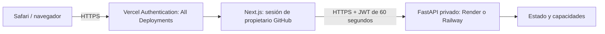

# JARVIS privado — preparación sin publicación

Fecha de verificación: 19 de noviembre de 2026.

## Estado

No se creó ningún proyecto de alojamiento, no se conectó OAuth real, no se
contrató ningún servicio y no se hizo push ni despliegue. Los cambios de la etapa
anterior se guardaron en el commit local `4dd8f8b`; esta preparación continúa en
la rama `prep/private-personal-assistant`.

El nuevo panel es adaptable a móvil y comprueba la conexión privada con FastAPI.
**Todavía no hay chat operativo ni agentes personales ejecutando tareas.** No
se muestran respuestas de demostración como si fueran de una IA real. El código
histórico de investigación se conserva, pero no se expone desde el nuevo panel.

## Diseño de acceso



Hay dos controles diferentes para la interfaz:

1. **Vercel Authentication, All Deployments:** restringe todas las URLs,
   incluidos producción, previews y dominios personalizados. Solo tu cuenta de
   Vercel debe tener acceso; no agregar colaboradores ni enlaces de bypass.
2. **Auth.js + GitHub:** solo admite el ID numérico estable de tu cuenta, mediante
   `JARVIS_OWNER_GITHUB_ID`. El nombre o correo no bastan para autorizar acceso.
   No hay registro público. Activa 2FA o passkeys en GitHub y Vercel.

FastAPI valida firma HS256, emisor, audiencia, propietario, emisión y caducidad.
La credencial dura como máximo 60 segundos. Next.js la crea únicamente después
de comprobar tu sesión. La clave compartida nunca se entrega al navegador y es
distinta de la clave de sesión. No se aceptan cabeceras de identidad inventadas.

El navegador llama al proxy del mismo origen `/api/backend/health` o
`/api/backend/services`: no guarda tokens en localStorage ni necesita cookies de
terceros para comunicarse con FastAPI. La sesión de Auth.js usa cookies HttpOnly,
SameSite y Secure cuando el sitio funciona con HTTPS; dura ocho horas. Cerrar
sesión borra la cookie; rotar `AUTH_SECRET` invalida las sesiones existentes.

Sin configuración, el panel redirige al acceso cerrado y la API privada responde
503. Con configuración pero sin credencial, FastAPI responde 401. Otra identidad
recibe 403. Solo `/healthz` es público: devuelve exclusivamente `{"status":"ok"}`.
La aplicación de producción no expone Swagger ni OpenAPI.

## Privacidad y tiempo real

- `private_main:app` es la entrada de producción. No importa visión, scraping,
  Telegram ni agentes, y no descarga modelos.
- El backend histórico `main:app` también tiene la barrera de autenticación;
  `JARVIS_PERSONAL_MODE=true` bloquea sus rutas de captura, investigación y agentes.
- WebSockets de voz/gafas se cierran con código 4403, no se intenta un proxy
  WebSocket a través de las funciones de Vercel.
- Todas las funciones públicas existentes de Convex rechazan consultas y
  mutaciones; el proveedor del navegador no abre conexiones aunque exista una URL.
- Antes de habilitar SSE, WebSockets o Convex habrá que implementar autenticación
  de propietario, expiración, revocación y autorización en cada operación. Una URL
  de Convex o un código de sala no son credenciales.
- Cámara, micrófono y geolocalización se bloquean también mediante cabeceras del
  navegador. No hay reconocimiento de desconocidos ni investigación invasiva activa.

Los cambios locales no modifican un eventual despliegue antiguo que ya exista.
Si lo hay, revisarlo y restringirlo en el proveedor antes de utilizarlo. No se
consultaron ni modificaron proyectos externos en esta preparación.

## Alojamiento y costo estimado

Precios orientativos en USD/mes, antes de impuestos, uso adicional y cambios del
proveedor. Se consultaron las páginas oficiales en la fecha indicada.

| Servicio | Costo base | Evaluación |
| --- | --- | --- |
| Vercel Hobby, uso personal | $0 dentro de cuotas | Recomendado para Next.js; All Deployments con Vercel Authentication sin costo adicional |
| Vercel Pro | Desde $20 por mes | No necesario para este acceso personal inicial |
| Render Free web service | $0 dentro de límites | Se suspende tras 15 minutos sin tráfico; no es backend siempre activo |
| Render Starter web service | Desde $7, 512 MB RAM | Recomendación de costo predecible para la API ligera |
| Render, instancia de 2 GB | Desde $25 | Alternativa si los futuros agentes necesitan más memoria |
| Railway Hobby | Mínimo $5, con $5 de uso incluidos | Siempre activo; factura por recursos, $5 no es un precio fijo ilimitado |
| Worker adicional en Render | Desde aproximadamente $7 | Solo cuando existan tareas durables; se suma a la API |
| APIs de IA / navegador cloud | Según consumo | No incluidas en el alojamiento ni conectadas aquí |

**Presupuesto inicial recomendado: Vercel Hobby + Render Starter, unos $7/mes
de alojamiento**, sujeto a cuotas y capacidad. Para API y worker separados,
partir de unos $14/mes. Railway puede comenzar en $5, pero hay que medir memoria,
CPU, almacenamiento y tráfico y fijar alertas/límites adecuados.

Render y Railway pueden alojar procesos FastAPI y workers permanentes. Vercel
se usa para interfaz y solicitudes breves, no para un agente residente ni un
servidor WebSocket. Los futuros agentes deben ejecutar trabajos en el backend o
en un worker con cola persistente, reintentos e historial; no basta con crear una
tarea en memoria dentro de una función serverless.

MongoDB Atlas y Convex no son necesarios para esta comprobación de acceso.
La persistencia del chat y los trabajos aún no está implementada; no conectar
una base ni afirmar que el historial queda guardado hasta completar esa parte.

## Servicios y variables que tendrás que conectar

En **Vercel, solo variables de servidor**:

| Variable | Valor requerido |
| --- | --- |
| `AUTH_URL` | URL HTTPS estable de la interfaz |
| `AUTH_SECRET` | Secreto aleatorio de al menos 32 bytes, exclusivo de sesiones |
| `AUTH_GITHUB_ID` | Client ID de tu GitHub OAuth App |
| `AUTH_GITHUB_SECRET` | Client secret de esa OAuth App |
| `JARVIS_OWNER_GITHUB_ID` | ID numérico de tu cuenta de GitHub |
| `JARVIS_BACKEND_URL` | URL HTTPS de la API alojada |
| `JARVIS_BACKEND_AUTH_SECRET` | Otro secreto aleatorio de al menos 32 bytes |

En **Render o Railway**:

- `JARVIS_ENV=production`
- `JARVIS_PERSONAL_MODE=true`
- El mismo `JARVIS_OWNER_GITHUB_ID`
- El mismo `JARVIS_BACKEND_AUTH_SECRET`

Las variables de backend se leen del entorno o de un `.env` local ignorado.
Nunca usar prefijo `NEXT_PUBLIC_` para secretos. Los archivos de ejemplo tienen
valores vacíos; las credenciales usadas en pruebas son ficticias y no sirven para
producción. No se generaron claves reales. El escaneo de patrones reconocibles
no encontró claves en los archivos revisados; esto no sustituye una auditoría de
todo el historial público. Si alguna clave estuvo publicada, debe revocarse.

## Pasos después de tu autorización

1. Mantener el repositorio local en esta rama hasta revisar los cambios. Antes
   de subirlo, comprobar que una integración GitHub→Vercel existente no publique
   automáticamente previews. El workflow de este repositorio ya no despliega al
   hacer push: exige ejecución manual y confirmación positiva.
2. Crear la GitHub OAuth App en tu cuenta. Callback de producción:
   `https://TU-INTERFAZ/api/auth/callback/github`. Una app OAuth separada para
   desarrollo evita mezclar callbacks y credenciales.
3. Crear el proyecto Vercel con raíz `frontend`, **sin desplegar todavía**, usando
   Projects API o `vercel projects add`; evitar el flujo de importación que
   inicia un despliegue automáticamente.
   Configurar **Deployment Protection → Vercel Authentication → All Deployments**
   antes del primer despliegue; revisar excepciones, bypasses y personas con acceso.
   El JSON de `deploy/vercel-protection.request.json` documenta la configuración;
   no activa nada por estar en Git y no es una opción de `vercel.json`.
4. Crear la API cuando apruebes el costo. Plantilla sin aplicar:
   `deploy/render.private.yaml`, con despliegue automático desactivado. Construir
   `backend/Dockerfile.private`; arranca `private_main:app`, respeta `$PORT` y
   ejecuta como usuario no root. Para Railway usar ese mismo Dockerfile y variables.
5. Guardar los secretos en los paneles de ambos proveedores. Verificar protección
   total de Vercel con `scripts/check_vercel_protection.py`: es una consulta de
   lectura y el workflow aborta si no obtiene `ssoProtection.deploymentType=all`.
6. Desplegar solo tras aprobación. Comprobar HTTPS en ambas URLs, rechazo de
   acceso directo a la API, sesión de propietario y cierre de sesión. Vercel y
   Render/Railway proporcionan certificados para sus dominios administrados.
7. Abrir la URL HTTPS desde Safari en iPhone/iPad. Iniciar sesión en Vercel y
   GitHub; después puedes usar «Compartir → Añadir a pantalla de inicio».
   No hace falta una computadora encendida una vez que ambos servicios estén alojados.

Los previews deben conservar la protección total. No compartir secretos de
producción con previews de código no confiable. OAuth requiere un callback
estable; no asumir que cualquier URL de preview funcionará con la misma OAuth App.

## Verificación local

```bash
cd backend
uv sync --locked --extra dev
uv run pytest
uv run ruff check .
uv run uvicorn private_main:app --host 127.0.0.1 --port 8000
```

En otra terminal:

```bash
cd frontend
npm ci
npm test
npm run typecheck
npm run build
npm run dev -- --hostname 127.0.0.1
```

Sin OAuth configurado se verá el acceso cerrado; es el comportamiento esperado.
En desarrollo `AUTH_URL=http://localhost:3000` y
`JARVIS_BACKEND_URL=http://127.0.0.1:8000` son válidos. El proxy rechaza HTTP hacia
el backend en producción.

Pruebas de navegador:

```bash
npx playwright install chromium
npm run test:e2e
# WebKit requiere además las bibliotecas del sistema:
npx playwright install --with-deps webkit
npm run test:safari
```

Resultados de esta preparación:

- Backend completo: **315 pruebas pasan, 5 omitidas**, cobertura **47,37 %**.
- Ruff pasa. Frontend: **28 pruebas pasan**, TypeScript y build pasan.
- **9 pruebas E2E pasan** en Chromium, con tamaños de escritorio, iPhone e iPad.
  Comprueban acceso anónimo, sesión local de propietario, conexión real al FastAPI
  local mediante JWT, rechazo de otro ID y cierre de sesión.
- Se usan sesiones sintéticas de Auth.js en E2E. **No se probó OAuth real de GitHub**.
- WebKit se descargó, pero faltan bibliotecas nativas y el entorno no permite la
  instalación administrativa. **Safari real y dispositivos físicos quedan pendientes**;
  las pruebas de tamaños móviles no equivalen a probar el motor Safari.
- Docker se construyó localmente con dependencias bloqueadas por hash. Para el
  proxy de red de este entorno fue necesario pasar su CA como secreto de build;
  no se desactivó TLS ni se incorporó ese certificado a la imagen de producción.
- La auditoría inicial detectó vulnerabilidades en dependencias heredadas. Se
  actualizó Next.js a 16.4.6 y la base privada a FastAPI 0.165.0, Starlette 1.10.0
  y PyJWT 2.15.1. `npm audit` terminó con **cero vulnerabilidades conocidas**;
  `pip-audit` de `requirements-private.txt` también terminó sin hallazgos.
  Esto no es una auditoría de todos los adaptadores históricos de investigación,
  que no se incluyen en la imagen privada ni se habilitan en este panel.
- Quedan **4 errores de lint y 18 advertencias** en componentes históricos
  conservados. No están montados en el panel privado; no se ocultaron las reglas.
- No se hizo ninguna prueba contra una API de IA ni se activó un despliegue.

Auth.js v5 se usa en su versión beta bloqueada por `package-lock.json`; la
elección permite sesiones sin añadir una base de datos. Validar la OAuth App real,
Safari y las opciones de seguridad del proyecto es obligatorio antes de uso real.

## Fuentes oficiales de precios y protección

- [Vercel: All Deployments](https://vercel.com/docs/deployment-protection#all-deployments)
- [Cambio del 9 de septiembre de 2026: producción protegida gratis](https://vercel.com/changelog/protect-production-deployments-for-free-on-every-plan)
- [Vercel Authentication](https://vercel.com/docs/deployment-protection/methods-to-protect-deployments/vercel-authentication)
- [Vercel: precios](https://vercel.com/pricing)
- [Render: precios](https://render.com/pricing)
- [Render: límites gratuitos](https://render.com/docs/free)
- [Railway: precios](https://railway.com/pricing)
- [Auth.js: GitHub](https://authjs.dev/getting-started/providers/github)
